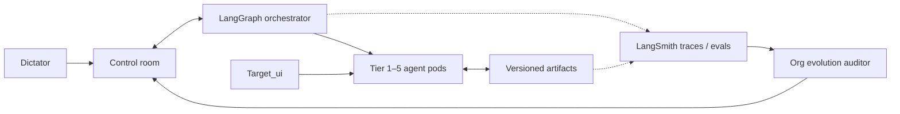

# UI/UX Agent Company

A **LangGraph + LangSmith + OpenCode** agent company for native Android social-app UI/UX design, implementation, QA, maintenance, and organizational evolution.

The Dictator (you) issues a decree. The company classifies it, runs discovery, designs, critiques itself, pauses for your approval, plans the Compose implementation, runs QA, and assembles a release candidate. A separate evolution graph proposes improvements to the company itself — with a shadow evaluation, your approval, and rollback.

**Read the constitution:** [`ui_ux-agent_company.md`](ui_ux-agent_company.md)

---

## Quick start

```bash
cd /home/pluto/main_projects/Team_of_agents_designing_UI_ux

python3 -m venv .venv
.venv/bin/pip install -e ".[dev]"

# 1. Deterministic, zero-token demo
.venv/bin/uiux demo

# 2. Control room
.venv/bin/uiux serve --host 127.0.0.1 --port 8765
# open http://127.0.0.1:8765

# 3. Real model run through OpenCode (design-only)
.venv/bin/uiux run "Redesign the profile screen: identity-first, one primary action, calm media grid, all states" \
  --mode design --auto-approve --demo

# 4. Tests
.venv/bin/pytest -q
```

The default model is `modal/deepseek-v4.1-flash-1017` through the project-local OpenCode agent `uiux-worker`. Check what your OpenCode install can reach:

```bash
opencode models
```

---

## What is in the box

```
org/
  architecture_registry.yaml     # agents, tiers, models, pods, gates, metrics
  project_profile.yaml            # Dhunchat / Orphic binding, Target_ui, device matrix
  budget_policy.yaml               # token budget + thresholds
  schemas/                         # JSON Schema contracts
src/ui_ux_company/
  graph.py                         # LangGraph design company
  evolution.py                     # separate evolution graph
  gateway.py                       # OpenCode model gateway (text + images)
  target_ui.py                     # scan, manifest, vision analysis, diff
  agents.py                        # role runner
  prompts.py                       # role prompts + JSON output contracts
  api.py                           # FastAPI control room + SSE
  cli.py                           # uiux demo/run/serve/evolve...
  storage.py                       # SQLite runs, events, approvals, token ledger
  artifacts.py                     # versioned artifact store
  static/                          # dependency-free control room
tests/                             # 11 passing tests
target_ui_example/                 # generated placeholder reference image
ui_ux-agent_company.md             # full constitution
```

### Architecture at a glance



---

## Commands

| Command | Purpose |
|---|---|
| `uiux demo` | Developer smoke test with deterministic mock models. Zero tokens. The production dashboard never uses mock data. |
| `uiux run "<decree>" --mode design` | Run a real design-only decree. |
| `uiux run "<decree>" --mode full --demo` | Run through implementation/QA with simulated QA (labeled). |
| `uiux serve` | Start the control room at `http://127.0.0.1:8765`. |
| `uiux target-ui scan ./target_ui_example --analyze` | Scan and vision-analyze Target_ui images. |
| `uiux evolve --focus quality` | Ask the independent org auditor for an evolution proposal. |
| `uiux budget` | Show token spend and remaining budget. |
| `uiux purge-mock` | Remove old mock/demo runs, approvals, artifacts, and mock token rows from the local DB. |
| `uiux registry` | Print the registry summary and Mermaid org chart. |
| `uiux models` | Show model aliases and the OpenCode backend. |
| `uiux health` | Check local configuration. |

---

## Model gateway: why OpenCode?

You asked to reuse the models already configured in OpenCode. The gateway shells out to:

```bash
opencode run --agent uiux-worker --format json --model <model> [--file image] "<prompt>"
```

`opencode.jsonc` defines `uiux-worker` with **all tools denied** (no edits, no shell, no reads, no web). It is a pure text/vision worker. The app never copies provider keys; OpenCode owns provider configuration.

Model aliases live in `org/architecture_registry.yaml`:

- `reasoner` — architecture, synthesis, critique, evolution
- `vision` — Target_ui analysis and visual review
- `coder` — implementation planning
- `critic` — independent review (use a different model in production for true independence)
- `cheap` — budget-pressure routing

Change the model in the registry or `.env`:

```bash
UIUX_OPENCODE_MODEL=modal/deepseek-v4.1-flash-1017
```

**Quota note:** free/paid OpenCode models can hit provider limits. If that happens, switch the registry model to one your account can reach. `uiux demo` always works without provider tokens.

---

## Target_ui

Drop reference images into `target_ui_example/` (or point `UIUX_TARGET_UI_PATH` at a folder). The company:

1. Hashes each image.
2. Maps it to a screen.
3. Uses a vision model to extract layout, components, color roles, typography, states, and confidence.
4. Writes `artifacts/target_ui/manifest.json`.
5. Uses the manifest in visual design and visual QA.

**Precedence:** target wins layout/composition; design tokens and Android/a11y law win color, type, and accessibility; conflicts escalate to the Dictator.

`target_ui_example/profile_reference.png` is a generated placeholder, not a real product screenshot. For competitor screenshots: use structure only, replace brand assets, and run legal/IP review.

---

## Evolve / Improve

The dashboard button and `uiux evolve` run a separate graph:

```
observe → diagnose → propose → evaluate → Dictator approval → apply safe changes
```

The auditor is independent from the orchestrator. It cannot approve or apply its own proposal. Safe mutations are limited to agent enabled/disabled, model alias swaps, gate thresholds, and budget caps. The previous registry version is backed up to `org/registry_history/`.

The current shadow evaluation is a heuristic MVP. Production should use LangSmith datasets/experiments and a golden task set before approval.

---

## Roborazzi is removed

Visual QA uses a **Screen Capture Adapter**, not Roborazzi:

- Primary: deterministic emulator/Waydroid state + UiAutomator idle wait + `adb exec-out screencap -p`.
- Optional: Gradle Managed Devices, Firebase Test Lab, manual upload.
- Diff: Pillow MVP; OpenCV/SSIM + OCR + color/contrast + region checks in production.
- Why: real GPU output for Liquid Glass/AGSL/RenderEffect; no JVM layoutlib limitations; tool-agnostic.

Upload screenshots to the control room via `POST /api/runs/{run_id}/screenshots` when you have real captures.

---

## Dashboard controls

- **Project directory:** Settings → Project directory → Browse. The selected path is injected into new-run context.
- **Target_ui directory:** Settings or Target_ui tab → Browse. Scan or Scan + analyze.
- **Model:** Header model selector or Settings → OpenCode model. It lists every model returned by `opencode models`; the selected model is saved as the default for new runs, and each run can override it.
- **Budget:** Click the header budget pill or Settings → Monthly token budget → Edit. Changes persist to `org/budget_policy.yaml` and `.runtime/settings.json`.
- **Live Flow:** Full hierarchical agent graph. Icons show idle / running / completed / error / waiting. Click any agent for status, last event, artifacts, and token usage.
- **Evolution:** Start audit, watch Observe → Diagnose → Evaluate → Approve → Apply cards, stop the audit, and Approve / Reject / Dictate.
- **Approvals:** Every pending decision is in the Dictator inbox with Approve / Reject / Dictate.

## Token budget

`org/budget_policy.yaml` defaults to **100,000,000 tokens/month** as a placeholder. Replace it with your actual ceiling in the dashboard or:

```bash
UIUX_MONTHLY_TOKEN_BUDGET=250000000
```

The ledger records every model call (estimated tokens by default). At 80% non-critical work routes to the cheap alias; at 95% new runs require approval; at 100% non-critical work stops. 15% is reserved for incidents.

The dashboard shows used/remaining tokens, estimated cost, top agents, and top models.

---

## Current limitations (honest)

- **Local MVP:** SQLite, in-process event bus, no auth/RBAC.
- **Implementation is a plan/patch contract**, not an autonomous commit. Code execution should be a separate, sandboxed OpenCode build-worker path with Git worktrees.
- **Visual QA** has the adapter contract and upload path; the full emulator/ADB automation is the next production step.
- **Functional/a11y QA** accepts test evidence; it does not yet drive UIAutomator/Espresso itself.
- **Evolution shadow eval** is heuristic; production needs LangSmith experiments and golden tasks.
- **LangSmith** is optional via env and not required for local operation.
- **Figma** is optional; the default source of truth is spec-first + Compose + screenshots.

The full production upgrade path is in [`ui_ux-agent_company.md`](ui_ux-agent_company.md), sections 14–19.

---

## API

Start the server, then:

```bash
curl http://127.0.0.1:8765/api/health
curl http://127.0.0.1:8765/api/registry
curl http://127.0.0.1:8765/api/budget
curl -X POST http://127.0.0.1:8765/api/runs \
  -H 'Content-Type: application/json' \
  -d '{"prompt":"Redesign the profile screen","mode":"design","backend":"mock","demo":true,"auto_approve":true}'
```

SSE: `GET /api/runs/{run_id}/events`

Approvals: `GET /api/approvals`, `POST /api/approvals/{id}/decide`

Evolution: `POST /api/evolve`, `GET /api/evolve`, `POST /api/evolve/{id}/approve`

---

## Tests

```bash
.venv/bin/pytest -q
```

Current coverage: registry validation, Target_ui scan, model gateway, mock graph end-to-end, API health, evolution proposal/reject.
