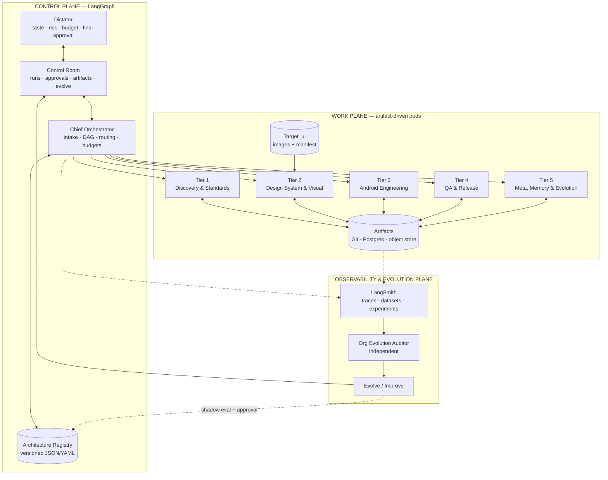
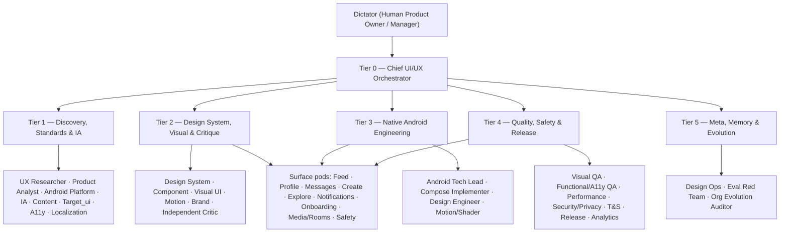
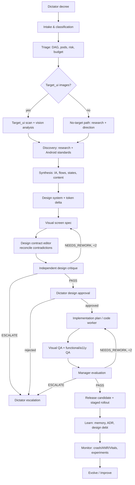
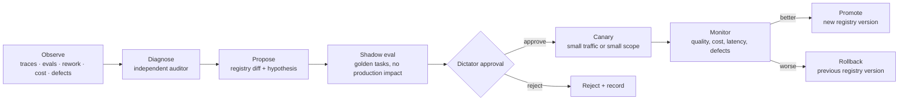

# ui_ux-agent_company.md

**Native Android Social Media UI/UX Agentic Company**

| Field | Value |
|---|---|
| Status | ACTIVE — v1.0 |
| Owner | **Dictator (Human Product Owner / Manager)** |
| Control plane | LangGraph |
| Flight recorder / eval lab | LangSmith |
| Model gateway | OpenCode headless worker (`uiux-worker`) |
| Android target | Kotlin + Jetpack Compose + Material 3, minSdk 24 / compileSdk 36 |
| First project binding | Dhunchat / Orphic (`com.example.dhunchat`) |
| Source of truth | `org/architecture_registry.yaml` + `org/project_profile.yaml` + `org/budget_policy.yaml` |
| Visual QA | Emulator/ADB capture harness. **Roborazzi is removed.** |

> This document is the human-readable constitution. The machine-readable org chart is the registry. If the two disagree, the registry is the executable truth and this document must be updated in the same change.

---

## 1. Executive summary

This is not “a group of agents that chat.” It is a **design company with an operating system**:

- **LangGraph** runs the company: intake, routing, task DAGs, gates, retries, budgets, human interrupts.
- **Versioned artifacts** are how agents communicate: product briefs, flows, tokens, screen specs, critiques, QA reports, release candidates. No long unstructured agent-to-agent transcripts.
- **Surface pods** do the work: Feed, Profile, Messages, Create, Explore, Notifications, Onboarding/Settings, Media/Rooms, Safety.
- **Independent gates** enforce quality: design critique, human design approval, visual QA, functional/a11y QA, performance, security/privacy, Trust & Safety, release.
- **LangSmith** is the flight recorder and eval lab: traces, datasets, experiments, evaluators, annotation queues, Studio.
- **The control room** is the Dictator’s interface: org chart, live runs, approval inbox, target-vs-render review, token budget, and the Evolve/Improve workflow.
- **The evolution graph** is a separate, audited change-management process. Agents may propose organizational changes; they may not approve or apply their own proposals.

The design goal is **human-governed autonomy**:

> Agents do the work; the Dictator owns direction, taste, risk, budget, and release authority.

### 1.1 What is implemented in this repository

| Capability | Status |
|---|---|
| LangGraph design pipeline | Implemented: intake → Target_ui → discovery → synthesis → design system → visual design → critique → human gate → implementation plan → QA → manager evaluation → release → memory |
| OpenCode model gateway | Implemented: headless `uiux-worker` agent, JSON output, image attachments, token estimates |
| Target_ui ingestion | Implemented: folder scan, hashes, screen mapping, vision analysis, manifest, tiered precedence |
| Evolution loop | Implemented: observe → diagnose → evaluate → human approval → safe registry apply |
| Control room | Implemented: dependency-free SPA served by FastAPI, live SSE, approvals, budget, artifacts, evolution |
| Token ledger | Implemented: per-run/agent/model usage, budget summary, 80/95/100% policy hooks |
| Android capture | Adapter contract + upload path; emulator/ADB harness is the production implementation |
| LangSmith | Optional integration via environment; traces/evals are the production requirement |
| Autonomous code commits | Not enabled by default; implementation produces a plan/patch contract. Code execution is a separate, explicitly approved worker path. |

### 1.2 The one-sentence operating rule

> **LangGraph routes the work, Postgres/Git remember it, LangSmith measures it, the control room lets the Dictator govern it, and Android rendering — not code reading — proves it.**

---

## 2. Locked decisions and non-negotiables

1. **The Dictator is the human Product Owner/Manager.** Final authority on direction, taste, risk, budget, overrides, and releases. The title is intentional; the behavior is professional.
2. **Plain-English escalation.** Every doubt or suggestion shown to the Dictator must explain what the user will see/feel, the risk, and 2–3 one-click options. No jargon dumps.
3. **Artifact-based communication.** Agents consume typed artifacts and produce typed artifacts. Chat history is not a contract.
4. **Independent verification.** The agent that authored a design may not be the only reviewer. The critic and QA gates are independent.
5. **Roborazzi is removed.** Visual QA uses the **Screen Capture Adapter**, with emulator/Waydroid + ADB/UiAutomator as the primary implementation. Optional backends: Gradle Managed Devices, Firebase Test Lab, manual upload.
6. **Target_ui is optional and tiered.** If images exist, the company uses them. If not, it takes the research-led path. Target images never override accessibility or Android platform law.
7. **The Evolve button is a workflow, not a mutation.** Observe → diagnose → propose → shadow eval → Dictator approval → canary → promote/rollback. No self-approval.
8. **Token budget is a hard operating constraint.** Budget is measured in total tokens per month. At 80% non-critical work routes to the cheap alias; at 95% new runs need approval; at 100% non-critical work stops. Incidents get a reserved buffer.
9. **Figma is optional.** The default source of truth is spec-first + Compose + rendered screenshots. A Figma adapter can be added later for import/export, variables/styles, and critique comments. Figma is not a runtime dependency.
10. **No hardcoded model IDs in prompts.** Model bindings live in the registry as capability aliases (`reasoner`, `vision`, `coder`, `critic`, `cheap`) with fallbacks.
11. **Simulated evidence is labeled.** A demo run may simulate QA, but the artifact says `simulated: true` and cannot be represented as production evidence.
12. **Production release requires evidence.** Real screenshots, real functional/a11y checks, and a Dictator release decision. No silent shipping.

---

## 3. How big-tech Android UI/UX teams actually work

This is a **publicly observable composite**, not a claim about Instagram’s or X’s private internals. The useful pattern is consistent across mature product organizations:

- **Product-area pods** own outcomes: Feed, Stories/Reels, Messaging, Creation, Growth, Integrity, Profile, Notifications.
- **Horizontal platform teams** provide shared leverage: design systems, UX research, content design, design engineering, accessibility, localization, design ops, data science.
- **Designers sit with PM, engineering, data, and research.** Decisions are made in a room with the people who must build, measure, and defend them.
- **Rituals create quality:** weekly critique, cross-functional design review, launch review, post-launch readout, design-debt review.
- **The design system is a versioned product**, not a Figma file: tokens, components, APIs, deprecation, migration, documentation, and design-code parity.
- **Quality is gated:** visual QA, accessibility, performance, privacy, trust & safety, localization, and release readiness.
- **Launches are staged and measured:** feature flags, gradual rollout, crash/ANR/Vitals monitoring, experiments, rollback plans.
- **Maintenance is continuous:** OS upgrades, Compose/Material upgrades, design drift audits, screenshot baselines, component deprecation, design debt.

### 3.1 Mapping the big-tech function to this company

| Big-tech function | Agent equivalent | Artifact |
|---|---|---|
| VP/Design Director | `chief_orchestrator` | task DAG, evaluation report, escalation |
| Product Manager | `product_analyst` | product brief, success metrics, acceptance criteria |
| UX Researcher | `ux_researcher` | research findings, evidence table, unknowns |
| Android Platform UX | `android_platform_designer` | Android constraints, required states |
| Interaction Designer | `ia_interaction_designer` | user flows, screen inventory, state matrix |
| Content Designer | `content_designer` | content spec, string catalog |
| Design Systems Architect | `design_system_architect` | design tokens, token delta |
| Component Lead | `component_design_engineer` | component spec, Compose API |
| Product Designer | `visual_ui_designer` | screen spec, target reconciliation |
| Motion Designer | `motion_haptics_designer` | motion/haptic spec, performance budget |
| Design Critic / Bar Raiser | `independent_design_critic` | critique, gate result, rework instructions |
| Android Design Engineer | `compose_implementer` | implementation plan, code patch, tests |
| Design Engineer | `design_engineer` | platform change, parity report |
| Visual QA | `visual_qa_inspector` | visual QA report, diff images |
| Accessibility QA | `functional_a11y_qa` | a11y report, functional report |
| Performance QA | `performance_qa` | performance report |
| Security/Privacy | `security_privacy_reviewer` | security/privacy review |
| Trust & Safety | `trust_safety_reviewer` | T&S review |
| Release Manager | `release_manager` | release candidate, rollout/rollback plan |
| Data Science | `analytics_experimentation_lead` | instrumentation, experiment plan, readout |
| Design Ops / Program Manager | `design_ops_librarian` | memory, index, design debt |
| AI Quality / Red Team | `eval_red_team` | eval report, scorecards |
| Independent Org Auditor | `org_evolution_auditor` | evolution proposal, rollback plan |

---

## 4. Operating model

### 4.1 Three planes



### 4.2 Artifacts, not conversations

Every agent interaction has a `TaskContract`:

```json
{
  "task_id": "task-profile-042",
  "run_id": "run_20261029_132724_739aedfd",
  "issued_by": "chief_orchestrator",
  "assigned_role": "visual_ui_designer",
  "model_binding": "vision",
  "worker_runtime": "opencode",
  "goal": "Design the profile screen with identity-first hierarchy and all required states",
  "inputs": [
    "artifacts/runs/<run>/product_brief.json",
    "artifacts/runs/<run>/user_flows.json",
    "artifacts/runs/<run>/design_tokens.json",
    "artifacts/runs/<run>/target_manifest.json"
  ],
  "acceptance_criteria": [
    "Every color, type, spacing, radius, elevation, and motion decision references a semantic token",
    "Default, loading, empty, error, offline, long-text, and permission-denied states are specified",
    "Primary action is unmistakable within 0.5 seconds",
    "All touch targets are at least 48dp",
    "Target_ui reference is reconciled; deviations are recorded"
  ],
  "output_artifacts": ["screen_spec.json"],
  "risk": "medium",
  "budget_tokens": 250000,
  "rework_count": 0,
  "max_retries": 2,
  "status": "in_progress"
}
```

### 4.3 Autonomy ladder

| Level | Behavior | Use |
|---|---|---|
| **L0** | Agents advise only. | Research/strategy. |
| **L1** | Agents produce specs/designs; the Dictator implements. | Early exploration. |
| **L2** | Agents design, build, test, and open PRs; the Dictator merges. | **Launch default.** |
| **L3** | Agents auto-merge low-risk changes after all gates; the Dictator approves high-risk changes and releases. | **Target after ~20 clean runs.** |
| **L4** | Agents release within budget/policy; the Dictator monitors and can veto. | Research goal, not a starting point. |

Promotion from L2 to L3 requires: at least 20 completed runs, zero critical escapes, first-pass yield ≥ 0.60, and a 20% human spot-check rate. Demotion is automatic on a critical escape or a budget breach.

### 4.4 Decision rights (RACI summary)

| Decision | Accountable | Responsible | Consulted | Informed |
|---|---|---|---|---|
| Product direction | Dictator | `product_analyst` | `ux_researcher`, `chief_orchestrator` | all |
| Design direction | Dictator | `visual_ui_designer` | `design_system_architect`, critic, a11y | pods |
| Token/design-system breaking change | Dictator | `design_system_architect` | `design_engineer`, critic | all |
| Implementation architecture | `android_tech_lead` | `compose_implementer` | design system, QA | orchestrator |
| Design critique | `independent_design_critic` | critic | a11y, Android, content | author |
| Release | Dictator | `release_manager` | QA, security, T&S | all |
| Org evolution | Dictator | `org_evolution_auditor` | eval red team, orchestrator | all |
| Safety/privacy exception | Dictator | security/privacy reviewer | legal, T&S | all |

---

## 4.5 Company Brain, hierarchy, and the common feed

The Chief does not manage from a single prompt. It receives a compact **Company Brain**:

- `company_brief.json`: codenames, titles, tiers, reporting lines, missions, inputs/outputs, gates, playbooks.
- `org_brief()`: queryable org graph; who owns what, who reports to whom.
- `routing_plan`: the Chief's interpretation, assumptions, chosen playbook, selected agents, DAG, gates, risks, and budget. It is written as an artifact and visible in the dashboard.
- `company feed`: short structured status updates from every agent. All agents can read it; only the assigned agent acts.

### Hierarchy

```
CEO agent (A1)
  └── Chief UI/UX Orchestrator (A2)
        ├── Discovery & Standards Lead (A3) → Tier 1 specialists
        ├── Design Lead (A4) → Tier 2 specialists
        ├── Engineering Lead (A5) → Tier 3 specialists
        ├── Quality & Release Lead (A6) → Tier 4 specialists
        └── Meta, Memory & Evolution Lead (A7) → Tier 5 specialists
```

- At **L0–L2**, the human is CEO + Dictator; the CEO agent advises and maintains the operating system.
- At **L3**, the CEO agent shares operating authority; major decisions escalate to the human.
- At **L4**, the CEO agent runs the company; the human is Dictator only (veto, major escalations, release authority as configured).
- Lower-level agents may collaborate with peers in their pod and read the feed, but decisions and escalations go up their reporting line. A **critical bypass** is allowed with a reason and an audit notification.
- The pyramid improves accountability and delivery consistency. It does not replace independent critique, real user evidence, Target_ui/current-UI fidelity, or evals.

### Feed contract

```json
{
  "run_id": "run_...",
  "from_agent": "A22",
  "to_agent": "A16",
  "kind": "handoff | review | artifact | feedback | escalation | instruction | broadcast",
  "did": "Completed independent critique",
  "doing": "Sending rework instructions",
  "needs": "Resolve the offline-state contradiction",
  "artifact": "design_critique.json",
  "confidence": 0.82,
  "created_at": "..."
}
```

The dashboard draws thin colored lines from these messages:

- purple: handoff
- blue: review
- green: artifact
- red: feedback/rework
- amber: escalation/instruction
- grey: broadcast

This is transparency without a free-form chat room. The feed is not a command channel; task contracts remain the command channel.

---

## 5. Org chart and roster

### 5.1 Tiers



### 5.2 Core roster

The registry is the authoritative list. These are the enabled MVP agents:

| ID | Tier | Real-world equivalent | Mission | Primary gates |
|---|---|---|---|---|
| `ceo` (`A1`) | 0 | CEO / Head of Product | Company operating system, priorities, constraints, cross-tier conflicts; escalates major decisions to the human Dictator. | CEO review |
| `chief_orchestrator` (`A2`) | 0 | VP Product Design & Release Director | Intake, routing through leads, budgets, escalation, evaluation. Does not author. | manager evaluation |
| `discovery_lead` (`A3`) | 1 | Director of Product Discovery | Tier 1 management, upstream criteria, evidence quality. | tier 1 review |
| `design_lead` (`A4`) | 2 | Director of Product Design | Tier 2 management, design contract, target fidelity, critique. | tier 2 review |
| `engineering_lead` (`A5`) | 3 | Director of Android Design Engineering | Tier 3 management, Compose, parity, merge safety. | tier 3 review |
| `quality_lead` (`A6`) | 4 | Director of Quality & Release | Tier 4 management, evidence, release blockers. | tier 4 review |
| `meta_lead` (`A7`) | 5 | Director of Design Ops & AI Quality | Tier 5 management, memory, evals, evolution. | tier 5 review |
| `product_analyst` | 1 | Staff Product Manager | Problem, users, metrics, scope, risk, acceptance criteria. | product brief review |
| `ux_researcher` | 1 | Senior Staff UX Researcher | Evidence, competitor patterns, friction, unknowns. | research review |
| `android_platform_designer` | 1 | Android Platform UX Specialist | Predictive back, insets, IME, adaptive, foldables, permissions. | platform review |
| `ia_interaction_designer` | 1 | Lead Interaction Designer | IA, flows, navigation, state matrix, interaction rules. | IA review |
| `target_ui_analyst` | 1 | Reference Librarian + Visual Analyst | Ingest images, map screens, extract layout/tokens, flag conflicts. | target review |
| `design_system_architect` | 2 | Staff Design Systems Architect | Tokens, themes, type, spacing, radius, elevation, motion primitives. | design-system review |
| `visual_ui_designer` | 2 | Senior Product Designer | Screen composition, hierarchy, states, target reconciliation. | design critique |
| `design_contract_editor` | 2 | Design Program Lead / Cross-functional Editor | Reconcile synthesis, tokens, screen spec, and target reference into one authoritative contract; resolve contradictions explicitly. | design critique |
| `independent_design_critic` | 2 | Design Critique Bar Raiser | Clean-context red team; PASS/REWORK/ESCALATE. Cannot author. | design critique |
| `compose_implementer` | 3 | Senior Android Design Engineer | Compose plan, state, previews, tests, verification. | code review, visual/functional QA |
| `visual_qa_inspector` | 4 | Visual QA Automation Lead | Screenshot vs spec/target, device matrix, perceptual diff. | visual QA |
| `functional_a11y_qa` | 4 | Staff Android Quality & Accessibility Engineer | Flows, states, TalkBack, focus, font scale, contrast, touch targets. | functional/a11y |
| `release_manager` | 4 | Android Release Manager | RC, staged rollout, monitoring, rollback, notes. | release |
| `org_evolution_auditor` | 5 | Independent Operating Model Auditor | Metrics-backed evolution proposal; cannot approve/apply. | evolution approval |

### 5.3 Extended / on-demand roster

`content_designer`, `accessibility_specialist`, `localization_specialist`, `component_design_engineer`, `motion_haptics_designer`, `brand_illustration_designer`, `android_tech_lead`, `design_engineer`, `motion_shader_engineer`, `performance_qa`, `security_privacy_reviewer`, `trust_safety_reviewer`, `analytics_experimentation_lead`, `design_ops_librarian`, `eval_red_team`.

These are disabled by default to keep the MVP cheap and legible. Enable them when a measured bottleneck appears; do not hire agents for status.

### 5.4 Surface pods

| Pod | Screens | Primary agents | Key risks |
|---|---|---|---|
| **Feed / Home** | home feed, post card, story bar, comments | visual, Compose, visual QA | Jank, media loading, hierarchy, long text |
| **Profile / Identity** | profile header, media grid, moments, edit profile, followers | visual, Compose, visual QA | Long names, empty grid, blocked/restricted, 200% font |
| **Messages / Chat** | inbox, conversation, requests, composer, attachments | visual, Compose, functional/a11y | Realtime states, IME, offline queue, unread badges |
| **Create / Publish** | create post, story/reel composer, audience picker, upload | visual, Compose, functional/a11y | Permissions, progress/retry, destructive actions |
| **Explore / Search** | explore grid, suggestions, results, filters, people search | visual, Compose, visual QA | Query states, empty/error, content density |
| **Notifications** | activity, detail, badges, preferences | visual, Compose, functional/a11y | Scanability, grouping, red indicator-only rule |
| **Onboarding / Auth / Settings** | splash, login, signup, permissions, settings, privacy | visual, Compose, functional/a11y | Trust, permission timing, error recovery |
| **Media / Player / Rooms** | mini-player, now playing, queue, live room, room chat | visual, Compose, performance | Album-art glass exception, audio focus, background |
| **Safety / Moderation** | report, block, mute, content warning, appeal | visual, Compose, T&S | Clear consequences, reversible actions, vulnerable users |

A cross-pod change is a **platform change**: it requires design-system + design-engineering review and a migration plan. A pod may not silently change a shared component.

---

## 6. Request lifecycle



### 6.1 Stages

1. **Intake** — classify the request: new feature, redesign, micro-fix, design-system change, maintenance, incident, org evolution. Extract scope, surfaces, constraints, success metrics, risk, budget.
2. **Triage** — build a task DAG, choose pods, identify parallel work, set gates. Ask the Dictator only when a one-way-door decision is ambiguous.
3. **Target_ui ingestion** — scan, hash, map, analyze. If no images, take the research-led path and ask the Dictator to pick a visual direction.
4. **Discovery** — research + Android standards in parallel. Label evidence strength and unknowns.
5. **Synthesis** — IA, flows, navigation, all six non-happy states, content rules.
6. **Design system** — token delta, theme rules, component contracts. No raw values downstream.
7. **Visual design** — screen spec, hierarchy, states, target reconciliation, deliberate deviations.
7.5 **Design contract** — `design_contract_editor` reconciles synthesis, tokens, screen spec, and Target_ui into one authoritative contract. Contradictions are resolved explicitly or listed for the Dictator. Critique reviews the contract, not disconnected artifacts.
8. **Critique** — independent, clean-context, evidence-based. Max two automatic rework loops, then escalate.
9. **Human design gate** — Dictator approves, rejects, or overrides with a recorded rationale.
10. **Implementation** — tech lead plan, isolated worktree, Compose, previews, tests. Shared files require a change request.
11. **QA** — visual, functional, a11y, performance, security/privacy, T&S in parallel. Real evidence required for release.
12. **Manager evaluation** — deterministic gate aggregation plus model summary. The manager cannot rubber-stamp a failed gate.
13. **Release** — RC, staged rollout, feature flags, monitoring, rollback, release notes.
14. **Learn** — memory entry, ADR, design debt, follow-ups, rework taxonomy.
15. **Monitor & evolve** — telemetry, incidents, metrics; the evolution graph proposes improvements.

### 6.1.1 Modes

| Mode | What it does | Implementation path |
|---|---|---|
| **Explore** | Research, evidence, and 2–3 design directions; no implementation. | design-only |
| **Design** | Full design package + critique + Dictator gate. | design-only |
| **Build** | Design + surgical implementation plan/patch. | implement |
| **Ship** | Design + build + QA + release candidate. | full |
| **Audit** | Critique/QA the current UI; no new visual direction unless requested. | design-only + current-UI baseline |
| **Fix** | Fast micro-fix with visual diff and focused QA. | design-only fast lane |

### 6.2 Fast lanes

- **Micro-fix lane:** lint + visual diff + one designer + one implementer + QA. Still gated, shorter DAG.
- **Incident lane:** rollback first, then root cause, then fix, then postmortem. The Dictator is notified immediately; reserved token budget applies.
- **Design-system lane:** design-system architect + design engineer + migration plan + visual regression across all pods.
- **Content/localization lane:** content designer + localization specialist + pseudo-locale screenshots; no code merge until strings are stable.

---

## 7. Requirement 1 — Target_ui subsystem

### 7.1 Configuration

`org/project_profile.yaml`:

```yaml
target_ui:
  mode: auto                 # auto | required | off
  path: docs/target_ui
  candidate_paths:
    - docs/target_ui
    - target_ui_example
    - /home/pluto/Documents/Target_ui
  manifest: artifacts/target_ui/manifest.json
  precedence: tiered          # tiered | pixel_perfect | inspiration
  confidence_threshold: 0.80
  on_conflict: escalate
  max_images_per_run: 8
  analyze_with_vision: true
  rights_policy: "Layout and hierarchy reference only; replace brand assets, fonts, icons, and copy. Legal/IP review before release."
```

### 7.2 Pipeline

1. **Detect** the folder and any new/changed images by SHA-256.
2. **Classify** each image: screen, device frame, orientation, theme, state.
3. **Map** the image to the screen inventory. Filename heuristics are only a first pass; the vision agent confirms.
4. **Extract** layout regions, components, spacing, color roles, typography roles, states, and confidence.
5. **Reconcile** with the design system and Android law. Record conflicts instead of silently guessing.
6. **Manifest** the result. Every image gets an ID, hash, screen, confidence, extracted data, conflicts, rights, and approval state.
7. **Use** the manifest in visual design and visual QA.
8. **Fallback** when no images exist: research-led direction, moodboard, Dictator direction pick. Never invent a target.
9. **Re-analyze** when the image hash changes; deprecate stale entries.

### 7.3 Precedence

| Dimension | Winner |
|---|---|
| Layout and composition | Target_ui (if authoritative) |
| Color, typography, spacing tokens | Design system, unless the Dictator records an explicit override |
| Accessibility | Always accessibility and Android law |
| Platform behavior | Always Android platform law |
| Brand assets, fonts, copy | Project brand; never copy competitor assets |
| Conflict | Escalate to the Dictator with 2–3 plain-English options |

### 7.4 Manifest example

```json
{
  "version": "1.0",
  "generated_at": "2026-10-29T13:27:00Z",
  "source_path": "/home/pluto/main_projects/Team_of_agents_designing_UI_ux/target_ui_example",
  "precedence": "tiered",
  "confidence_threshold": 0.8,
  "status": "analyzed",
  "images": [
    {
      "image_id": "target_01",
      "file": "target_ui_example/profile_reference.png",
      "sha256": "f57b8ad8...",
      "width": 1080,
      "height": 2400,
      "screen": "profile",
      "state": "default",
      "theme": "dark",
      "status": "analyzed",
      "confidence": 0.86,
      "extracted": {
        "layout": "identity header + action row + segmented media grid",
        "components": ["avatar", "primary_pill", "glass_pill", "segmented_tabs", "media_tile"],
        "conflicts": ["Reference uses a brand-specific icon set; replace with the project icon system."]
      },
      "rights": "reference_only"
    }
  ]
}
```

### 7.5 Current UI baseline

`current_ui` is separate from Target_ui:

- Target_ui is the visual north star for the new design.
- Current UI is the audit and visual-regression baseline.
- Both folders can be browsed manually or found with recursive search patterns:
  - target: `target_ui`, `target-ui`, `reference_ui`
  - current: `current_ui`, `screenshots_of_current_ui`, `current_screens`
- If Target_ui is empty, the Target_ui Analyst posts an instruction to the Design Lead and the company proceeds research-led.
- If Current UI is empty, Visual QA posts an instruction to the Quality Lead; audit and regression evidence are limited until screenshots are captured.
- Project validation checks for Gradle, AndroidManifest, Compose, design tokens, and both UI folders. Invalid projects are warned, not silently accepted.

### 7.6 Annotation editor

Target images can be annotated with rectangles and component/region labels. Annotations are stored on the manifest image and passed to the Target_ui Analyst as authoritative region hints. This is human guidance layered on top of vision extraction, not a replacement for it.

### 7.7 Legal and ethical policy

- Competitor and third-party images are **reference only**.
- Extract structure, hierarchy, and interaction patterns. Do not copy logos, proprietary illustrations, exact color systems, fonts, or copy.
- Use generated or licensed assets for production.
- Record provenance and rights in the manifest.
- Run a legal/IP check before release for any target-derived design.
- If an image is AI-generated, record the generation source and treat it as a mood reference, not a correctness target.

---

## 8. Requirement 2 — the Evolve / Improve engine

### 8.1 What the button does

The dashboard button starts a **separate evolution graph**:



### 8.2 Inputs

- LangSmith traces, eval scores, judge calibration, regression alerts.
- Rework rate, first-pass yield, cycle time, defect escape rate, human override rate.
- Token ledger: burn rate, cost per screen, top consumers, budget pressure.
- Gate failures: critique issues, a11y defects, visual diff failures, missing evidence.
- Incidents, rollbacks, postmortems.
- New project requirements: new surfaces, new locales, new devices, new compliance constraints.

### 8.3 Proposal contract

```json
{
  "proposal_id": "evo_quality_001",
  "title": "Add a dedicated Content Design gate before critique",
  "problem": "Empty-state copy is repeatedly caught late by the critic and owned by no one.",
  "evidence": [
    "3 of 5 recent critiques contain a copy finding",
    "content_designer is disabled in the registry",
    "No string catalog artifact exists in the run"
  ],
  "changes": [
    {
      "type": "enable_agent",
      "target": "content_designer",
      "from": false,
      "to": true,
      "rationale": "Make microcopy an explicit, reviewed artifact before critique."
    }
  ],
  "expected_impact": {
    "quality": "Fewer copy defects and late rewrites",
    "speed": "Slightly longer discovery, shorter rework",
    "cost": "+3–5% tokens per run",
    "risk": "Low; advisory agent, no code edits"
  },
  "risks": ["One more handoff", "Possible duplicate copy work"],
  "eval_plan": [
    "Run 5 golden profile/feed tasks with and without the content gate",
    "Compare critique copy findings and rework loops"
  ],
  "rollback_plan": "Disable content_designer and restore the previous registry version from org/registry_history/.",
  "status": "pending_approval"
}
```

### 8.4 Guardrails

- **No self-approval.** The proposer, approver, and applier are different.
- **Immutable base policy:** safety, approval policy, data access, release authority.
- **Safe mutations only:** enable/disable agent, model alias swap, gate threshold, budget cap, pod composition. Structural changes require a code/deploy change.
- **Shadow eval required** before approval. Production uses LangSmith experiments and a golden task set.
- **Canary required** for changes that affect routing, models, or gates.
- **Rollback required.** Every proposal names the previous registry version and the restore command.
- **Budget cap per evolution cycle.**
- **Audit log** for every proposal, evaluation, decision, apply, and rollback.
- **One controlled change at a time** whenever possible; avoid confounding multiple variables.

### 8.5 What can evolve

| Mutable | Immutable without the Dictator |
|---|---|
| Agent enabled/disabled | Safety policy |
| Model alias binding | Approval policy |
| Prompt version | Data access policy |
| Routing weights | Release authority |
| Gate thresholds | The Dictator’s veto |
| Budget caps | Audit log retention |
| Pod composition | Legal/compliance constraints |
| Tool allowlist | Production secrets policy |

### 8.5.1 Metric canary and rollback

After a safe registry change is applied, the Evolution tab can run a small-scope metric canary over recent production runs. It records completed/escalated/failed counts, pass rate, scope, and verdict. A pass promotes the change; a fail exposes rollback. This is a metric heuristic, not a full LangSmith golden-task shadow eval.

### 8.6 Registry versioning

- `org/architecture_registry.yaml` carries `version`.
- Every applied change backs up the previous version to `org/registry_history/<version>.yaml`.
- Every change appends an `evolution_history` entry with proposal ID, timestamps, requested changes, applied changes, and a note that a graph rebuild/redeploy may be required.
- The live graph reads the registry at startup. A structural change is applied by deploys, not by hot-patching a running graph.

---

## 9. LangGraph architecture

### 9.1 State

The executable graph state (`CompanyState` in `src/ui_ux_company/graph.py`) carries:

- `run_id`, `prompt`, `mode`, `backend`, `demo`, `auto_approve`, `autonomy_level`
- `target_ui_enabled`, `target_ui_path`
- `change_request`, `target_manifest`, `research`, `synthesis`
- `design_tokens`, `screen_spec`, `critique`, `critique_gate`
- `design_approved`, `human_decision`
- `implementation`, `qa`, `qa_gate`
- `evaluation`, `eval_gate`
- `release`, `learnings`
- `rework_counts`, `errors`, `status`, `approval_id`

Artifacts are written to `artifacts/runs/<run_id>/` and indexed in SQLite. The graph state is checkpointed so a run can pause and resume.

### 9.2 Nodes and edges

| Node | Agent(s) | Output |
|---|---|---|
| `intake` | product_analyst | `product_brief.json`, `company_brief.json` |
| `ceo_review` | ceo | `ceo_directive.json`, `routing_plan.json` |
| `target_ui` | target_ui_analyst | `target_manifest.json` |
| `discovery` | ux_researcher + android_platform_designer (parallel) | `research_findings.json` |
| `synthesis` | ia_interaction_designer | `user_flows.json` |
| `design_system` | design_system_architect | `design_tokens.json` |
| `visual_design` | visual_ui_designer | `screen_spec.json` |
| `design_contract` | design_contract_editor | `design_contract.json` |
| `critique` | independent_design_critic | `design_critique.json` |
| `human_gate` | Dictator interrupt | `design_approval.json` |
| `implement` | compose_implementer | `implementation_plan.json` |
| `qa` | visual_qa_inspector + functional_a11y_qa | `qa_report.json` |
| `manager_eval` | chief_orchestrator | `evaluation.json` |
| `release` | release_manager | `release_candidate.json`, `RELEASE_NOTES.md` |
| `learn` | design_ops_librarian | `learnings.json` |
| `escalate` | chief_orchestrator | `escalation.json`, pending approval |

Conditional edges enforce:

- Critique pass → human gate.
- Critique needs rework and count ≤ max → visual design.
- Critique escalate or count exceeded → escalation.
- Human reject → escalation.
- Manager pass → release.
- Manager needs rework and count ≤ max → implementation.
- Manager escalate → escalation.

### 9.3 Human-in-the-loop

`human_gate` uses LangGraph `interrupt()`. The graph pauses, persists the checkpoint, and the control room shows a pending approval. Resuming sends `Command(resume={decision, ...})`. The approval is idempotent: the node checks for an existing pending approval before creating another.

### 9.4 Checkpointing and durability

- Local: `AsyncSqliteSaver` at `.runtime/checkpoints.sqlite3`.
- Production: `AsyncPostgresSaver` (or LangGraph Platform) with a durable Postgres instance.
- Run metadata and artifacts are also stored in SQLite/Postgres so the control room can list runs without replaying the graph.
- Retries are bounded by `max_rework` and model gateway retry attempts. Budget checks stop runaway loops.

### 9.5 Streaming

LangGraph events are published to the `EventBus` and stored in SQLite. The control room consumes SSE at `/api/runs/{run_id}/events`. Events include:

`run.started`, `stage.started`, `agent.started`, `agent.completed`, `agent.failed`, `artifact.created`, `gate.result`, `target_ui.ready`, `approval.required`, `screenshots.uploaded`, `run.paused`, `run.resumed`, `run.completed`, `run.failed`, `evolution.*`.

Do not stream raw chain-of-thought. Stream decisions, evidence, artifacts, and gate results.

---

## 10. LangSmith

LangSmith is the **flight recorder and eval lab**, not the control room.

### 10.1 Tracing

Set:

```bash
LANGSMITH_TRACING=true
LANGSMITH_API_KEY=lsv2_...
LANGSMITH_PROJECT=uiux-agent-company
```

Every LangGraph run should carry metadata:

- `run_id`
- `mode` (design / implement / full)
- `backend` (opencode / mock)
- `autonomy_level`
- `project` (Dhunchat)
- `registry_version`
- `agent_id`
- `task_id`
- `artifact_sha`

This makes traces filterable by run, agent, model, project, and registry version.

### 10.2 Datasets and experiments

- **Golden tasks:** a small set of representative decrees (profile redesign, feed card, empty state, a11y fix, target-image redesign, maintenance).
- **Expected artifacts:** screen spec, critique pass, QA report, release candidate.
- **Evaluators:** rubric-based LLM judge + deterministic checks (schema validity, token coverage, state coverage, target manifest usage, a11y check, budget).
- **Human calibration:** a sample of judge decisions is reviewed by the Dictator or a design lead. Track agreement.
- **Regression suite:** every new prompt/model/agent change runs the golden set before promotion.
- **Annotation queues:** the Dictator can label quality, taste, and escalation usefulness; those labels become eval data.

### 10.3 Studio

LangSmith Studio is for graph debugging and step-through. The custom control room is for operations. Do not confuse them.

---

## 11. Control room

### 11.1 Current implementation

A dependency-free SPA served by FastAPI:

- `src/ui_ux_company/static/index.html`
- `src/ui_ux_company/static/styles.css`
- `src/ui_ux_company/static/app.js`

The SPA uses a narrow left icon rail (labels on hover) and tabs:

- **Overview** — decree composer, recent runs, live timeline, compact org summary, quick approvals, token budget, quick artifacts, Target_ui mini-preview, evolution quick list.
- **Live Flow** — full-page hierarchical graph with CEO/Chief/tier leads/specialists, codenames A1–A36, idle/running/completed/stopped/error/waiting icons, current work labels, thin colored signal lines, company feed, live SSE events, zoom controls, and click-through agent detail. Terminal run states clamp every running node to completed/stopped/failed so no stale “running” indicator survives a stop.
- **Approvals** — sub-tabs for Pending and Decision history; source agent/codename, due time, overdue badge, approve/reject/dictate. Approvals attached to terminal runs are auto-dismissed into history at startup.
- **Artifacts** — run selector, artifact list, JSON/text/image preview, screenshot upload, and Re-run QA (reuses the existing run; no design rerun).
- **Contract** — versioned design-contract editor with Save version and Re-run critique.
- **Target_ui** — target + current-UI browse, recursive folder search, scan, scan + vision analysis, image grid, confidence, conflicts, and rectangle annotation editor.
- **Evolution** — start/stop audit, live Observe → Diagnose → Evaluate → Approve → Apply → Canary cards, agent output modals, proposal detail, Approve / Reject / Dictate, metric canary, promote, and registry rollback.
- **Settings** — active project switcher, project/current UI/Target_ui browse + Gradle/Manifest/Compose/token validation, searchable OpenCode model picker + model test, editable monthly token budget, autonomy level, webhook/browser notifications, token RBAC session, audit log, runtime info, and mock/demo data purge.

Production defaults:

- No mock/demo controls in the dashboard. The API keeps a test-only mock backend for automated tests; the production UI always uses OpenCode.
- The selected model is persisted in `.runtime/settings.json` and applied to new runs and evolution audits.
- The budget is persisted to `org/budget_policy.yaml` and `.runtime/settings.json`.
- Project/Current UI/Target_ui directories are persisted and injected into new-run context.
- Run stop cancels the graph task and the OpenCode subprocess; pending approvals are marked stopped.
- QA re-check reuses the existing checkpoint and updates `qa_report.json`/`evaluation.json`; it does not redo design.
- Design-contract edits are versioned; Re-run critique updates `design_critique.json`.
- Approvals carry `from_agent`, `from_codename`, `sla_minutes`, and `due_at`.
- The company feed is stored in `agent_messages` and streamed as `agent.message` events.
- Evolution rollback restores the previous registry version from `org/registry_history/`.

### 11.2 Production upgrade path

Replace the SPA with Next.js + React Flow when multi-user/RBAC is needed. Keep the API contract:

- `GET /api/health`
- `GET /api/auth/me`
- `POST /api/auth/login`
- `GET /api/audit`
- `GET /api/registry`
- `GET /api/project`
- `GET /api/projects`
- `POST /api/projects/{id}/activate`
- `GET /api/models`
- `GET /api/budget`
- `GET /api/target-ui`
- `POST /api/target-ui/scan`
- `POST /api/target-ui/annotations`
- `GET /api/target-ui/image?path=...`
- `GET /api/current-ui`
- `POST /api/current-ui/scan`
- `GET /api/current-ui/image?path=...`
- `GET /api/fs/search?root=...&patterns=...`
- `GET /api/project/validate?path=...`
- `POST /api/models/test`
- `POST /api/runs`
- `GET /api/runs`
- `GET /api/runs/{run_id}`
- `GET /api/runs/{run_id}/messages`
- `GET /api/runs/{run_id}/events` (SSE)
- `GET /api/runs/{run_id}/artifacts`
- `GET /api/artifacts/{run_id}/{name}`
- `POST /api/runs/{run_id}/screenshots`
- `POST /api/runs/{run_id}/stop`
- `POST /api/runs/{run_id}/recheck-qa`
- `POST /api/runs/{run_id}/agent-task`
- `GET /api/runs/{run_id}/design-contract`
- `PUT /api/runs/{run_id}/design-contract`
- `POST /api/runs/{run_id}/recritique`
- `POST /api/runs/{run_id}/approve`
- `GET /api/approvals`
- `POST /api/approvals/{approval_id}/decide`
- `POST /api/evolve`
- `GET /api/evolve`
- `GET /api/evolve/{proposal_id}`
- `GET /api/evolve/{proposal_id}/events` (SSE)
- `POST /api/evolve/{proposal_id}/approve`
- `POST /api/evolve/{proposal_id}/stop`
- `POST /api/evolve/{proposal_id}/canary`
- `POST /api/evolve/{proposal_id}/promote`
- `POST /api/evolve/{proposal_id}/rollback`

### 11.3 Authorization

Local MVP has no auth. Production requires:

- OIDC/SSO
- RBAC: Dictator, Design Lead, Engineer, Viewer
- Audit log for approvals and evolution changes
- CSRF protection, rate limits, request signing
- No production secrets in the control room process

---

## 12. Artifact model

### 12.1 Required artifacts

| Artifact | Producer | Consumer |
|---|---|---|
| `product_brief.json` | product_analyst | all |
| `target_manifest.json` | target_ui_analyst | visual design, QA |
| `research_findings.json` | ux_researcher | synthesis |
| `user_flows.json` | ia_interaction_designer | design system, visual |
| `design_tokens.json` | design_system_architect | visual, implementation |
| `screen_spec.json` | visual_ui_designer | design contract, implementation, QA |
| `design_contract.json` | design_contract_editor | critic, implementation, QA |
| `design_critique.json` | independent_design_critic | human gate, visual rework |
| `implementation_plan.json` | compose_implementer | tech lead, QA |
| `qa_report.json` | visual_qa + functional/a11y | manager, release |
| `evaluation.json` | chief_orchestrator | release/escalation |
| `release_candidate.json` | release_manager | Dictator, monitoring |
| `learnings.json` | design_ops_librarian | org memory |
| `evolution_proposal.json` | org_evolution_auditor | Dictator, eval |

### 12.2 Naming and versioning

- Run-scoped: `artifacts/runs/<run_id>/<name>.json`
- Global target manifest: `artifacts/target_ui/manifest.json`
- Registry history: `org/registry_history/<version>.yaml`
- Screenshots: `artifacts/runs/<run_id>/screenshots/`
- Target images copied for the run: `artifacts/runs/<run_id>/target_images/`

Every artifact has a SHA-256 hash and a producer. The control room links to the file. Git stores text artifacts; large images go to object storage (MinIO/S3) or Git LFS.

---

## 13. Storage and repository layout

### 13.1 Source of truth

Do **not** store the architecture as an image file. Use:

```
org/
  architecture_registry.yaml        # machine-readable org chart + policy
  project_profile.yaml              # per-project binding (Dhunchat)
  budget_policy.yaml                # token budget
  schemas/                          # JSON Schema for registry, contracts, manifests
  registry_history/                 # previous registry versions
  prompts/                          # versioned prompt templates (optional)
docs/
  ui_ux-agent-company.md            # this constitution
  diagrams/*.mmd                    # Mermaid source; SVG/PNG generated
artifacts/
  runs/<run_id>/                    # briefs, specs, critiques, QA, release
  target_ui/manifest.json            # target image metadata
  visual/                          # screenshots/baselines (object store in production)
```

- **Git** = registry, profiles, prompts, specs, ADRs, contracts.
- **Postgres** = LangGraph checkpoints, runs, approvals, audit, token ledger (production).
- **SQLite** = local MVP equivalent.
- **Object store / Git LFS** = large images, screenshots, target images.
- **LangSmith** = traces, datasets, experiments, annotation.
- **Mermaid source** = diagrams; generated SVG/PNG are build outputs, never edited.

### 13.1.1 Production adapters

- **LangGraph checkpoints:** set `UIUX_CHECKPOINT_BACKEND=postgres` and `UIUX_POSTGRES_DSN=...`; `AsyncPostgresSaver` is used. SQLite remains the local fallback.
- **Artifacts:** local files remain authoritative for the UI; when `UIUX_S3_BUCKET` is set, artifacts are mirrored to S3/MinIO and the artifact metadata records the `s3_uri`.
- **Docker Compose:** `docker compose up -d postgres minio` starts Postgres 16 and MinIO. The `app` profile is available for containerized deployment but requires OpenCode/provider access.
- **App metadata:** runs/events/approvals/token ledger still use SQLite in this build; a full Postgres metadata migration is the next production step.

### 13.1.2 Multi-project

- Project profiles live in `org/projects/<id>.yaml`.
- The Settings tab can activate a profile; it switches repo, Target_ui/current-UI paths, design system, and validation.
- Runs keep their historical state. Per-project budget isolation and simultaneous project execution are later steps.

### 13.2 Why not an image?

An image cannot be validated, diffed, queried, versioned as a contract, or used to route work. The registry is executable; the diagram is a view. The document is the narrative.

---

## 14. Android engineering standards

### 14.1 Design system

- Semantic tokens, not raw hex or ad-hoc dp.
- Token categories: color role, typography role, spacing, radius, elevation, motion, opacity, border.
- Themes: dark baseline; light only if the project explicitly supports it.
- Component contracts: slots, states, accessibility semantics, Compose API, previews.
- Versioning: breaking changes require a migration plan and a Dictator-approved design-system change.
- Design-code parity checks in CI.

### 14.2 Compose standards

- Stateless composables at the leaf; state hoisted to a `UiState`.
- `@Immutable`/`@Stable` models where appropriate.
- Stable keys in `LazyColumn`/`LazyVerticalGrid`/`HorizontalPager`.
- No hardcoded theme values.
- Edge-to-edge with `WindowInsets`.
- Predictive back for nested destinations.
- Configuration changes and process-death restoration.
- Previews for default, loading, empty, error, long text, RTL, 200% font.
- Screenshot capture scenarios with deterministic fake data.

### 14.3 Visual QA without Roborazzi

**Roborazzi is removed.** The `ScreenCaptureAdapter` interface has these backends:

| Backend | Use |
|---|---|
| `EmulatorAdbCapture` | **Primary.** Deterministic app state + UiAutomator idle wait + `adb exec-out screencap -p` |
| `GradleManagedDeviceCapture` | CI device matrix; instrumented screenshot tests |
| `FirebaseTestLabCapture` | Cloud devices; optional |
| `ManualUploadCapture` | The Dictator or a human uploads screenshots |

Capture requirements:

- Debug-only `ScreenshotScenario` registry with fake data, fixed clock, fixed locale, animations disabled.
- Device matrix: 360dp, 412dp, 200% font, RTL, dark/light where applicable.
- Capture real GPU output for Liquid Glass/AGSL/RenderEffect.
- Store screenshots with screen, state, device, locale, font scale, and SHA-256.

Visual diff:

- MVP: Pillow pixel diff + mean absolute difference + percent pixels over threshold.
- Production: OpenCV/SSIM + region crops + OCR text/clipping + color/contrast sampling + anti-aliasing tolerance.
- Thresholds are per screen/state, not one global number.
- Baseline updates require a human approval and a recorded reason.

### 14.4 Functional and accessibility QA

- Compose UI tests for critical flows.
- UIAutomator hierarchy dumps for real-device interaction.
- TalkBack labels, focus order, custom actions, 48dp targets, 200% font, contrast.
- Offline/error/retry/empty states.
- `AccessibilityChecks`/Accessibility Scanner where available.

### 14.5 Performance QA

- Macrobenchmark: startup, frame timing, jank.
- Perfetto traces for regressions.
- Memory, APK size, image loading, network behavior.
- Compose compiler stability reports and recomposition checks.
- Device matrix includes a low-end profile.

### 14.6 Device matrix

At minimum:

- 360dp compact phone
- 412dp large phone
- 200% font scale
- RTL locale
- dark theme
- offline/slow network
- foldable/tablet posture where the app supports it

---

## 15. Quality gates and release

| Gate | Owner | Pass criteria | Blocking |
|---|---|---|---|
| Product brief review | product_analyst | Problem, users, metrics, constraints, non-goals, acceptance criteria explicit | yes |
| Design critique | independent_design_critic | Score ≥ 0.80; no critical hierarchy/token/state/target/Android-law issues | yes |
| Human design approval | Dictator | Approve or recorded override | yes |
| Visual QA | visual_qa_inspector | Real screenshots pass per-screen thresholds on required devices | yes |
| Functional/a11y QA | functional_a11y_qa | Critical flows pass; no critical a11y defects; 48dp, TalkBack, 200% font, offline verified | yes |
| Performance | performance_qa | Budgets met; no regression beyond threshold | conditional |
| Security/privacy | security_privacy_reviewer | No critical findings; permissions minimized; PII protected | conditional |
| Trust & Safety | trust_safety_reviewer | Reporting/blocking/minors/policy risks addressed | conditional |
| Manager evaluation | chief_orchestrator | Deterministic aggregation of required gates + evidence | yes |
| Release | release_manager + Dictator | RC, staged rollout, monitoring, rollback, notes, Dictator approval | yes |

### 15.1 The seven-point critic checklist

1. Does the screen support the user’s primary task clearly?
2. Is the visual hierarchy obvious within 0.5 seconds?
3. Are spacing, typography, and color 100% consistent with the design tokens?
4. Are loading, empty, offline, error, partial-error, long-text, deleted/blocked, and permission states explicitly designed?
5. Does the layout survive 360dp width and 200% system font scale?
6. Are all touch targets at least 48dp, with TalkBack labels and focus order?
7. Does it obey the Dictator’s standing visual laws and Target_ui precedence?

### 15.2 Release

- Release candidate only when required gates pass with real evidence.
- Staged rollout: 1% → 5% → 25% → 100%.
- Feature flags and remote config for rollback.
- Monitor crash-free rate, ANR, startup, jank, Play Vitals, support signals, and success metrics.
- Rollback plan is part of the release artifact.
- Post-release readout feeds the learn loop and the evolution graph.

---

## 16. Security, privacy, legal, and safety

### 16.1 Threat model

Agents read target images, web research, user content, code, tool output, and potentially untrusted prompts. Risks include:

- Prompt injection that exfiltrates secrets or merges malicious code.
- Supply-chain compromise via generated dependencies.
- PII leakage in traces, artifacts, or prompts.
- Copyright/brand misuse from target images.
- Unsafe social features (harassment, minors, reporting gaps).
- Self-modifying org changes that weaken safety.

### 16.2 Controls

- **Least privilege:** the OpenCode worker agent has all tools denied. Code workers run in isolated worktrees/containers with scoped tokens.
- **No production secrets** in agent environments.
- **Network egress allowlist** for research and package installs.
- **Artifact signing/hashing** and provenance.
- **PII redaction** before traces/prompts; retention policy.
- **Prompt-injection defense:** wrap untrusted content, separate instructions from data, never let retrieved content change tool permissions.
- **Human approval** for permission changes, release, and org evolution.
- **Kill switch** for runs, agents, and the evolution apply step.
- **Audit log** for approvals, registry changes, and releases.
- **Legal/IP review** for target-derived designs.
- **Trust & Safety review** for social surfaces.

---

### 16.4 Auth, RBAC, and audit

- Token auth is optional via `UIUX_AUTH=true` and `org/users.yaml` (copy the example).
- Roles: **viewer** (read-only), **engineer** (run/stop/QA/agent dispatch), **design_lead** (contract/target edits), **dictator** (approvals, settings, projects, evolution, admin).
- Mutating requests are role-gated in middleware and written to `audit_log`.
- The UI prompts for a token on 401 and exposes session/audit in Settings.
- OIDC/SSO is the next production step; token RBAC is the local-first implementation.

---

## 17. Reliability, concurrency, and cost

### 17.1 Reliability

- LangGraph checkpoints for resumability.
- Idempotent nodes and approval creation.
- Bounded retries with backoff; no infinite loops.
- Per-run, per-task, and per-agent token caps.
- Dead-letter/incident lane for failed runs.
- Artifact locks to prevent two agents writing the same file.
- Git worktrees per implementation task; merge queue; protected shared files.
- Async Android builds; no blocking the orchestrator.
- Heartbeats and timeouts for long model/build calls.

### 17.2 Concurrency

- One writer per artifact.
- Shared files (`Navigation.kt`, `theme/`, shared components) are owned by the tech lead/design engineer; workers file change requests.
- Merge queue serializes integration.
- Design-system changes are platform changes, not pod-local changes.

### 17.3 Token budget

`org/budget_policy.yaml` is the source of truth:

- Monthly total tokens (default 100,000,000 — replace with the Dictator’s ceiling).
- Count input + output + reasoning; cached input tracked separately.
- Reserve 15% incidents, 5% evolution, 10% evals.
- Per-run 2M, per-task 500k, per-agent 250k, evolution 1M.
- 50/80/95 warnings.
- 80%: route non-critical work to the cheap alias.
- 95%: new runs require Dictator approval.
- 100%: hard stop non-critical; hotfix overage requires approval.
- Ledger fields: run, task, agent, model, input, output, cached, reasoning, cost, timestamp.
- Dashboard: burn rate, forecast, top consumers, cost per screen, remaining budget.

### 17.4 SLOs

- Run success rate ≥ 95% for design-only runs.
- First-pass design approval ≥ 60%.
- Rework rate ≤ 1.0 per screen.
- Visual defect escape ≤ 5%.
- Critical a11y defect escape = 0.
- Budget adherence = 100%.
- Approval latency tracked; no silent waiting.
- Build success rate ≥ 95%.
- Crash-free/ANR/startup/jank budgets per project profile.

---

## 18. What was missing from the original 12-agent diagram

This is the gap analysis the Dictator asked for. The original diagram had the right skeleton — manager, research, Android standards, IA, design system, visual, critic, implementation, QA, release. It was missing the layers that make a design org actually survive production.

### 18.1 Product truth

1. **Real user evidence.** Agents can research competitors, but they cannot invent what real users will do. Add analytics, beta testers, support/app-store mining, usability sessions, and a human research owner. Without this, the org optimizes its own rubric.
2. **Measurement and experimentation.** Event taxonomy, funnels, guardrail metrics, A/B/n, readouts. A design org that cannot measure outcomes is a mockup factory.
3. **Trust & Safety, privacy, legal, IP.** Reporting/blocking, minors, harassment, content warnings, consent, PII, Play policy, copyright. Non-negotiable for social.
4. **Human taste and accountability.** You can delegate work, not accountability. Keep a human design owner, diverse critique, and real user contact.

### 18.2 Craft truth

5. **Content design and localization.** Microcopy, tone, errors, empty states, RTL, string expansion, plurals, culture. Strings are artifacts.
6. **Accessibility as a gate.** WCAG 2.2 AA, TalkBack, switch access, 200% font, contrast, focus order, 48dp, reduced motion.
7. **Design engineering and design-system platform.** Tokens pipeline, component API, versioning, deprecation, codemods, design-code parity, screenshot tests.
8. **Design ops and program management.** Research repository, artifact taxonomy, templates, design debt, schedules, dependencies, approval SLAs.
9. **Device/performance matrix.** 360dp, foldables, tablets, 200% font, RTL, dark/light, offline/3G, IME, predictive back, edge-to-edge, low-end GPUs.
10. **Target_ui provenance and legal.** Manifest, hash, screen mapping, confidence, precedence, rights. Competitor screenshots are reference only.

### 18.3 Engineering truth

11. **Release management and incident response.** Staged rollout, flags, remote config, rollback, crash/ANR/Vitals, postmortem. Production starts after the release candidate.
12. **Reliability, concurrency, merge architecture.** Long Gradle builds, parallel edits, merge conflicts, retries, idempotency, locks, worktrees, merge queue, dead-letter, resumability.
13. **Security, sandboxing, prompt injection.** Least-privilege tools, sandboxed worktrees, no production secrets, egress allowlists, artifact signing, redaction.
14. **Model strategy and benchmarking.** Capability aliases, multimodal checks, cost/latency, per-role evals, fallbacks, cross-model critics.
15. **Eval harness and agent performance reviews.** Golden tasks, rubrics, calibrated judges, regression suites, red-team prompts, per-agent scorecards, drift.

### 18.4 Org truth

16. **Org memory and learning.** ADRs, design decisions, postmortems, rework taxonomy, banned patterns, preference graph, component deprecation, design debt.
17. **Governance, autonomy, change management.** RACI, decision rights, risk tiers, one-way vs two-way doors, approval matrix, audit, kill switch, rollback, change advisory board.
18. **Cross-artifact consistency.** Synthesis, tokens, screen spec, and target reference can contradict each other. Add a design-contract editor and a deterministic consistency audit before critique; otherwise the critic spends its cycles reconciling artifacts instead of raising the quality bar.
19. **Multi-project tenant core.** One constitution + many project profiles (archetype, tokens, target_ui path, device matrix, gates). Do not fork the org per app.
20. **Metrics, SLOs, and runbooks.** First-pass yield, rework rate, cycle time, cost per screen, defect escape, a11y defects, visual diff pass, human override rate, approval latency, build success, crash-free, ANR, startup, jank. Without SLOs, “better” is a vibe.

### 18.5 The three biggest gaps

1. **Real user truth** — without users, the org is a very fast guesser.
2. **Independent eval/quality gates** — without them, agents grade their own homework.
3. **Production safety around self-modification** — without it, the evolution button becomes an accident generator.

---

## 19. Roadmap

### Phase 0 — Foundations (implemented)

- Registry, project profile, budget policy, schemas.
- LangGraph design pipeline with mock and OpenCode backends.
- Target_ui scan + manifest.
- Evolution graph with safe apply.
- Control room SPA.
- SQLite storage and token ledger.
- Tests.

**Exit:** `uiux demo` completes; `uiux serve` works; mock and real OpenCode runs produce artifacts; tests pass.

### Phase 1 — UI shell, hierarchy, signals (implemented)

- Left icon rail.
- Full-page Live Flow with CEO/5 leads/codenames, work labels, signal lines, company feed.
- Real tier-lead review gates (discovery, design, engineering, quality).
- Approval source/SLA/decision history.
- Modes, model test, run stop.
- Minimal scrollbars.
- QA re-check after screenshot upload.
- Design-contract editor with versioning and Re-run critique.
- Evolution registry rollback; canary card as manual scope review.

### Phase 2 — File discovery and validation (implemented)

- Recursive Target_ui/current-UI folder search.
- Current-UI baseline manifest.
- Empty-folder instructions from the right agent at the right stage.
- Android project validation (Gradle/Manifest/Compose/tokens).
- Project/current/Target_ui folder pickers.

### Phase 3 — One real feature end-to-end

- Pick one surface: Profile screen (recommended).
- Add real Android capture harness (emulator/ADB) and screenshot scenarios.
- Add real functional/a11y test report ingestion.
- Run 5 design iterations with the Dictator.
- Calibrate the critic against the Dictator’s judgment.
- Measure first-pass yield, rework rate, token cost.

**Exit:** one approved Profile design package with real screenshots; critic calibration ≥ 0.7 agreement; token cost per screen measured.

### Phase 4 — Surface pods

- Enable Feed, Messages, Create, Explore, Notifications pods.
- Add content designer, accessibility specialist, localization specialist, performance QA.
- Add design-system versioning and component parity checks.
- Add LangSmith datasets/experiments and a golden task set.

**Exit:** 3+ pods shipping with the same gates; first-pass yield ≥ 0.60; no critical escapes.

### Phase 5 — Autonomous maintenance

- Scheduled design-drift audits.
- Dependency/OS upgrade lane.
- Screenshot baseline governance.
- Incident lane and postmortems.
- L3 autonomy for low-risk changes.

**Exit:** 20 clean runs; zero critical escapes; human spot-check rate 20%; rollback rehearsal passed.

### Phase 6 — Evolution lab

- Production LangSmith shadow evals.
- Canary and rollback automation.
- Model benchmarking per role.
- Multi-project profiles.
- L4 research pilots with strict caps.

**Exit:** evolution proposals have measurable hit rate; rollback is proven; cost per screen trends down without quality regression.

### Phase 7 — Production infrastructure

- Multi-project switcher with per-project profiles, budgets, artifacts, and Target_ui/current-UI folders.
- Auth/RBAC and audit log; local single-user fallback.
- Postgres + object storage (MinIO/S3) with SQLite fallback.
- Evolution canary/rollback UI and approval SLA notifications.
- Target_ui annotation editor and design-contract editor UI.

---

## 20. Appendices

### A. RACI matrix

| Stage | Accountable | Responsible | Consulted | Informed |
|---|---|---|---|---|
| Intake | Dictator | chief_orchestrator | product_analyst | all |
| Product brief | Dictator | product_analyst | ux_researcher, Android | all |
| Target_ui | Dictator | target_ui_analyst | design system, visual | all |
| Research | chief_orchestrator | ux_researcher | product, analytics | pods |
| IA/flows | chief_orchestrator | ia_interaction_designer | content, Android, a11y | pods |
| Tokens | Dictator (breaking) | design_system_architect | design engineer, critic | all |
| Visual design | Dictator (approval) | visual_ui_designer | critic, target, a11y | pods |
| Critique | chief_orchestrator | independent_design_critic | a11y, Android, content | author |
| Implementation | android_tech_lead | compose_implementer | design engineer, QA | orchestrator |
| Visual QA | chief_orchestrator | visual_qa_inspector | design, target | release |
| Functional/a11y QA | chief_orchestrator | functional_a11y_qa | Android, a11y | release |
| Release | Dictator | release_manager | QA, security, T&S | all |
| Evolution | Dictator | org_evolution_auditor | eval red team, orchestrator | all |

### B. Prompt template

```
ROLE: <agent role>
GOAL: <one-sentence task>
CONTEXT: <typed artifacts, not raw chat history>
OUTPUT SCHEMA: <JSON schema or hint>
RULES:
- Return only one valid JSON object.
- Separate evidence from assumptions.
- Do not invent user data or analytics.
- Reference semantic tokens, not raw values.
- Record uncertainty in `assumptions`.
- Do not ask questions; choose the safest reasonable interpretation.
```

### C. Runbook — failed run

1. Open the control room run detail.
2. Read `error.json` and the last `agent.failed` event.
3. Check budget, provider status, and the model gateway.
4. If the failure is transient, retry the run; if it is a prompt/schema failure, inspect the offending artifact.
5. If the failure is a design issue, rework; if it is a platform issue, fix the platform.
6. Write a short postmortem and add a regression eval if the failure can recur.

### D. Runbook — visual QA failure

1. Open `qa_report.json` and the diff artifacts.
2. Determine whether the failure is a render defect, a spec defect, or a baseline defect.
3. If render: send back to implementation with the specific screen/state/device.
4. If spec: send back to visual design and critic.
5. If baseline: require human approval before updating the baseline; record why.

### E. Runbook — evolution apply

1. Review the proposal, evidence, eval plan, and rollback plan.
2. Confirm the change is in the mutable set.
3. Approve in the control room.
4. The registry backs up the previous version and bumps the version.
5. Deploy/rebuild the graph.
6. Monitor the canary against the golden set.
7. Promote or roll back. Record the outcome.

### F. Glossary

- **Decree:** the Dictator’s natural-language change request.
- **Task DAG:** the directed acyclic graph of work for one decree.
- **Artifact:** a typed, versioned output consumed by another agent.
- **Gate:** a quality checkpoint with evidence and a pass/fail decision.
- **Pod:** a product-area team for a surface family.
- **Registry:** the versioned machine-readable org chart and policy.
- **Evolution:** an audited change to the org, its models, prompts, routing, gates, or budget.
- **Target_ui:** reference images plus a manifest; optional visual north star.
- **Screen Capture Adapter:** the abstraction that replaces Roborazzi and captures real rendered screenshots.
- **Simulated:** evidence produced by a mock/demo path; never production proof.

---

## 21. How to run this repository

```bash
cd /home/pluto/main_projects/Team_of_agents_designing_UI_ux
python3 -m venv .venv
.venv/bin/pip install -e ".[dev]"

# Deterministic, zero-token demo
.venv/bin/uiux demo

# Real OpenCode model run (design-only)
.venv/bin/uiux run "Redesign the profile screen" --mode design --auto-approve --demo

# Control room
.venv/bin/uiux serve --host 127.0.0.1 --port 8765
# open http://127.0.0.1:8765

# Target_ui scan
.venv/bin/uiux target-ui scan ./target_ui_example --analyze

# Evolution proposal
.venv/bin/uiux evolve --focus quality

# Budget
.venv/bin/uiux budget

# Remove old mock/demo runs from the local DB
.venv/bin/uiux purge-mock

# Tests
.venv/bin/pytest -q
```

**Model gateway note:** the project-local `opencode.jsonc` defines `uiux-worker` with all tools denied. It uses the model configured in `org/architecture_registry.yaml` (`modal/deepseek-v4.1-flash-1017` by default). Verify availability with `opencode models`. The gateway never copies provider keys into the app.

**Budget note:** `100,000,000` tokens/month is a placeholder. Replace it in `org/budget_policy.yaml` and `UIUX_MONTHLY_TOKEN_BUDGET`.

**Production note:** this repository is a local-first MVP. Production requires Postgres, object storage, auth/RBAC, sandboxed code workers, real emulator/device-farm capture, LangSmith datasets/experiments, and a deployed control room. The contracts and gates are designed for that upgrade.
